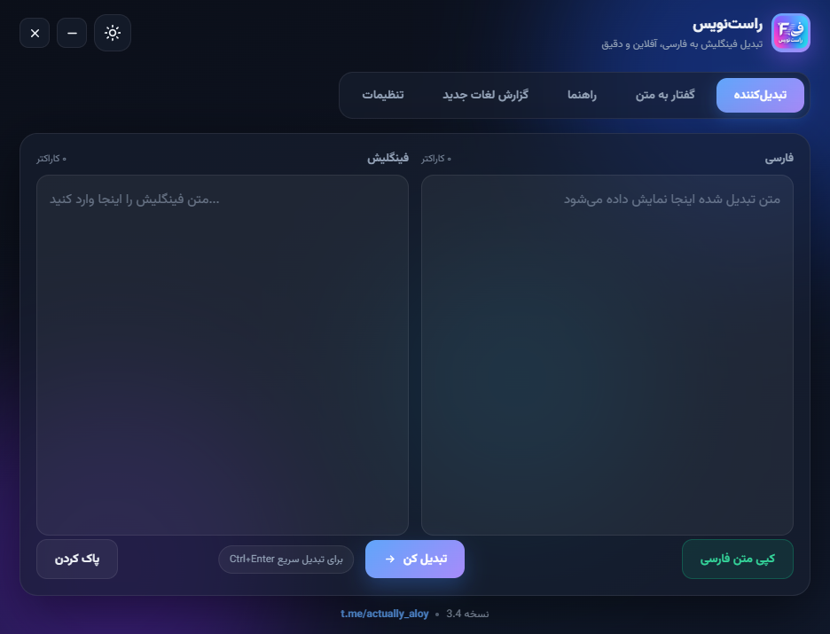
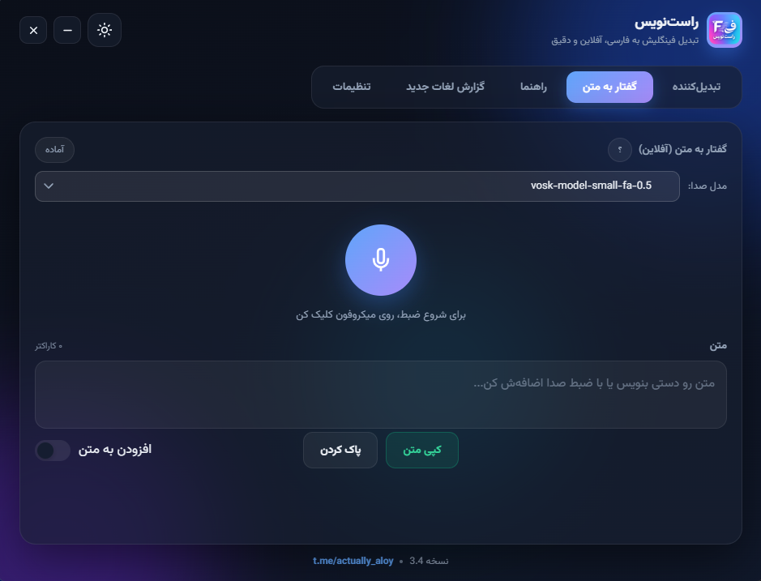
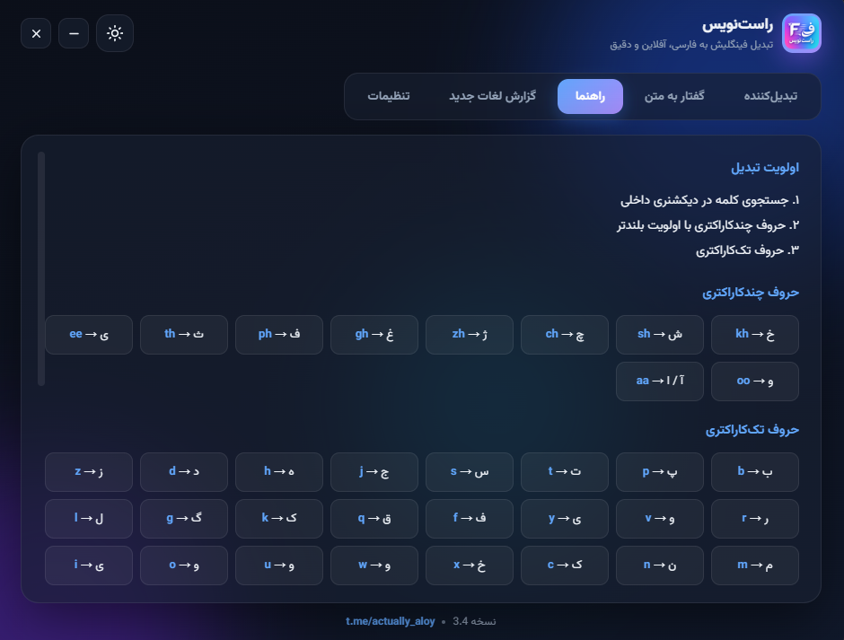
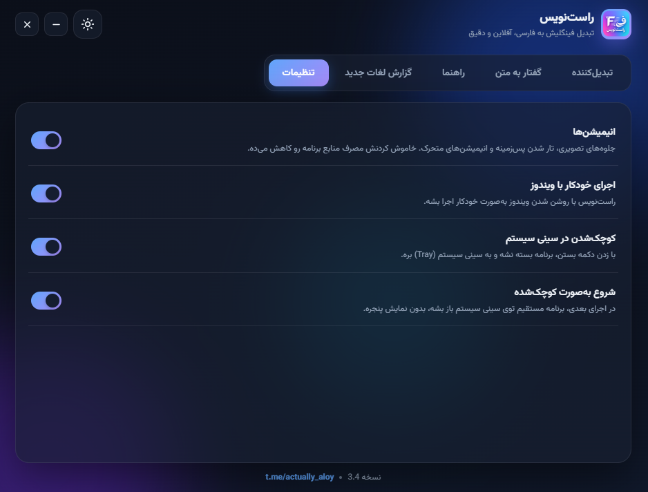

# راست‌نویس (Rastnevis) 🚀

**تبدیل هوشمند فینگلیش به فارسی | تبدیل صدا به متن**

راست‌نویس یک ابزار سبک، کاربردی و رایگان برای ویندوز است که تایپ فارسی را برای شما آسان می‌کند. اگر با کیبورد استاندارد انگلیسی تایپ می‌کنید اما می‌خواهید خروجی‌تان فارسی باشد، یا دوست دارید با استفاده از صدای خود متون را تایپ کنید، این نرم‌افزار دقیقاً همان چیزی است که نیاز دارید.

---

## 📖 راهنمای استفاده (چطور کار کنیم؟)

این برنامه دو بخش اصلی دارد. استفاده از هر دو بخش بسیار ساده است:

### ۱. تبدیل متن (فینگلیش به فارسی)
این بخش برای زمانی است که می‌خواهید متنی که به انگلیسی تایپ کرده‌اید را به فارسی برگردانید.
- در صفحه اول برنامه، متن انگلیسی خود را (مثلاً `salam man amir hastam`) در کادر **سمت چپ** (فینگلیش) بنویسید.
- روی دکمه آبی رنگ وسط کلیک کنید، یا کلیدهای **`Ctrl + Enter`** را هم‌زمان بزنید.
- متن به‌صورت خودکار (مثلاً `سلام من امیر هستم`) در کادر **سمت راست** (فارسی) ظاهر می‌شود.
- اگر می‌خواهید از اول شروع کنید، دکمه **"پاک کردن"** زیر کادر چپ را بزنید.

### ۲. تبدیل صدا به متن (Speech to Text)
این بخش به شما اجازه می‌دهد با صحبت کردن، متن خود را تایپ کنید.
- به تب **"گفتار به متن"** بروید.
- روی دکمه **مایک آبی بزرگ** کلیک کنید.
- شروع به صحبت کنید تا متن شما به صورت زنده تایپ شود.
- **نکته مهم:** برنامه به شما اجازه می‌دهد مدل‌های صوتی پیشرفته‌تری مثل `vosk` را برای دقت بالاتر انتخاب کنید. اما نگران نباشید؛ اگر نمی‌خواهید حجم دانلود کنید، برنامه **با یک مدل سبک و پیش‌فرض** کار می‌کند و نیاز به تنظیمات اضافی ندارد.
- اگر کلید **"افزودن به متن"** را روشن کنید، صحبت‌های جدید به انتهای نوشته قبلی اضافه می‌شود (به جای اینکه جایگزین شود).

---

## ⚙️ تنظیمات برنامه (برای راحتی بیشتر)

در بخش **"تنظیمات"** می‌توانید برنامه را مطابق سلیقه خود شخصی‌سازی کنید:
- **انیمیشن‌ها:** اگر دوست ندارید افکت‌های گرافیکی داشته باشید یا می‌خواهید منابع سیستم کمتری مصرف شود، این گزینه را خاموش کنید.
- **اجرای خودکار با ویندوز:** این گزینه را روشن کنید تا با روشن شدن کامپیوتر، برنامه هم بالا بیاید.
- **کوچک شدن در سینی سیستم (Tray):** وقتی این گزینه روشن باشد، با زدن دکمه ضربدر (X)، برنامه بسته نمی‌شود و به گوشه پایین سمت راست صفحه می‌رود.
- **شروع به‌صورت کوچک‌شده:** با روشن کردن این گزینه، برنامه دفعه بعد مستقیماً به سینی سیستم می‌رود و پنجره‌اش باز نمی‌شود.

---

## 🖥️ نیازمندی‌های سیستم

- سیستم‌عامل: **ویندوز** (نسخه‌های مدرن)
- فضای ذخیره‌سازی: بسیار کم (مگر اینکه مدل‌های صوتی بزرگ دانلود کنید)

---

## 🎨 تصاویر برنامه (Screenshots)

*(برای اینکه تصاویر به درستی نمایش داده شوند، مطمئن شوید پوشه‌ای به نام `screenshots` کنار فایل README دارید و تصاویر با همین نام‌ها در آن قرار دارند)*

  
   
  <em>صفحه اصلی: تبدیل فینگلیش به فارسی</em>
    
  
   
  <em>صفحه گفتار به متن و انتخاب ماژول صوتی</em>
    
  
   
  <em>راهنمای قوانین تبدیل حروف</em>
    
  
   
  <em>صفحه تنظیمات و شخصی‌سازی برنامه</em>

---

## 📞 ارتباط با ما

اگر سوالی دارید، باگ یا پیشنهادی برای بهبود برنامه دارید، خوشحال می‌شویم بشنویم. می‌توانید از طریق لینک زیر با سازنده برنامه در ارتباط باشید:

👉 **[تلگرام سازنده: t.me/actually_aloy](https://t.me/actually_aloy)**

*(روی لینک بالا کلیک کنید تا مستقیماً به صفحه تلگرام بروید)*
